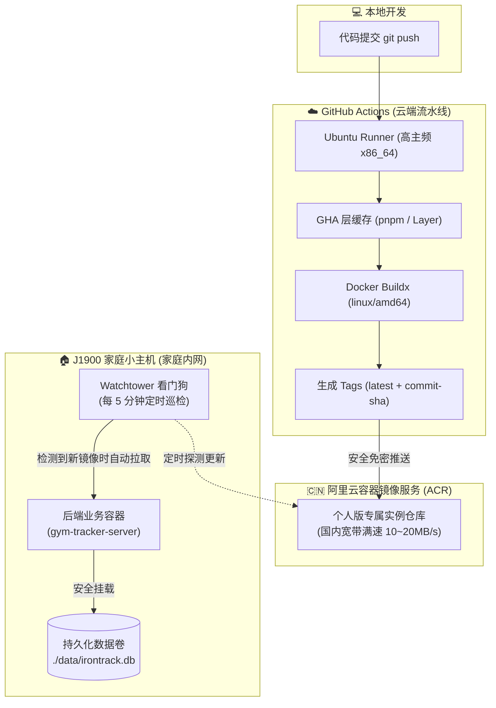

# 从代码提交到家庭小主机无感上线：GitHub Actions + 阿里云 ACR + J1900 自动化部署实战指南

> **摘要**：本文针对低功耗家庭小主机（如 Intel Celeron J1900、N100 等）在私有云/家庭服务器场景下的后端应用部署，详细介绍如何借助 **GitHub Actions** 进行云端高效交叉编译，通过 **阿里云容器镜像服务 (ACR)** 解决国内 Docker 镜像拉取慢与超时的痛点，并依托 **Watchtower 守护进程** 实现内网“零端口暴露”的主动巡检滚动更新。文末附带开源仓库敏感信息防护方案与实战踩坑全解析。

---

## 一、 背景与痛点：为什么不直接在 J1900 上构建？

在家庭 Homelab / 低功耗服务器运维中，常见的做法是通过 Git Pull 代码后在本地执行 `docker compose build`，但这在实际体验中存在诸多致命短板：

1. **J1900 算力羸弱，编译极其缓慢**：
   - Intel J1900 虽具备 x86 架构兼容性，但 CPU 性能仅适合日常低功耗运行。一旦遇到 TypeScript 编译、Node.js 原生 C++ 扩展（如 `better-sqlite3`）从源码编译时，CPU 瞬间 100% 满载，往往耗时数分钟甚至导致系统卡死。
2. **国内网络拉取海外公共仓库频繁超时**：
   - Docker Hub 限制频次且国内访问阻断严重，GitHub Packages (`ghcr.io`) 在普通家庭宽带下经常连接超时或丢包。
3. **家庭宽带无公网 IP，云端无法直连下发**：
   - 家庭服务器通常处于运营商 NAT 内网中，若采用传统的 CI/CD “推送模式（Push）”，需要给 GitHub Actions 开放 SSH 密钥、配置 DDNS 端口映射或内网穿透，不仅繁琐而且存在巨大安全隐患。

---

## 二、 整体设计架构：云端构建 + 国内中转 + 零暴露看门狗

针对上述痛点，我们设计了 **“云端高性能构建 ➔ 阿里云极速中转 ➔ J1900 内网主动巡检”** 的全自动 CI/CD 架构：



### 核心设计亮点：
* **免费高效**：充分利用 GitHub Actions 免费的 4 核高性能云主机进行编译，J1900 零算力开销。
* **网络极速**：镜像推送到阿里云 ACR 个人版专属实例（免费），J1900 拉取时跑满家庭宽带（几秒内完成）。
* **零暴露绝对安全**：J1900 无需公网 IP，不开放任何 SSH 端口给外部，依靠本地运行的 Watchtower “看门狗”主动定时探测。
* **平滑更新与垃圾自洁**：新旧容器原子级平滑替换，更新完成后自动清理悬虚镜像（Dangling images），防止 J1900 磁盘被撑爆。

---

## 三、 详细工程落地与配置代码

### 1. 云端构建流水线：`.github/workflows/docker-server.yml`

在 GitHub Actions 中开启 GHA 缓存，锁定 J1900 `linux/amd64` 平台，并解决阿里云 ACR 的兼容性：

```yaml
name: 构建与发布 J1900 Docker 镜像至阿里云 ACR

on:
  push:
    paths:
      - 'server/**'
      - '.github/workflows/docker-server.yml'
    branches: [ main, master ]
  workflow_dispatch:

concurrency:
  group: docker-server-${{ github.ref }}
  cancel-in-progress: true

jobs:
  build-and-push:
    name: 编译构建并推送至阿里云镜像服务
    runs-on: ubuntu-latest

    steps:
      - name: 检出代码
        uses: actions/checkout@v4

      - name: 设置 Docker Buildx
        uses: docker/setup-buildx-action@v3

      - name: 登录阿里云容器镜像服务 (ACR)
        uses: docker/login-action@v3
        with:
          registry: ${{ secrets.ALIYUN_ACR_REGISTRY }}
          username: ${{ secrets.ALIYUN_ACR_USERNAME }}
          password: ${{ secrets.ALIYUN_ACR_PASSWORD }}

      - name: 生成镜像元数据 (Tags)
        id: meta
        run: |
          REGISTRY="${{ secrets.ALIYUN_ACR_REGISTRY }}"
          NAMESPACE="${{ secrets.ALIYUN_ACR_NAMESPACE }}"
          IMAGE_NAME="gym-tracker-server"
          
          FULL_IMAGE="${REGISTRY}/${NAMESPACE}/${IMAGE_NAME}"
          SHORT_SHA=$(echo "${{ github.sha }}" | cut -c1-7)
          
          echo "tag_latest=${FULL_IMAGE}:latest" >> $GITHUB_OUTPUT
          echo "tag_sha=${FULL_IMAGE}:${SHORT_SHA}" >> $GITHUB_OUTPUT

      - name: 构建并推送 Docker 镜像 (优化 linux/amd64 与 GHA 缓存)
        uses: docker/build-push-action@v5
        with:
          context: ./server
          file: ./server/Dockerfile
          platforms: linux/amd64
          push: true
          tags: |
            ${{ steps.meta.outputs.tag_latest }}
            ${{ steps.meta.outputs.tag_sha }}
          # 关键排坑：禁用 OCI Attestations 兼容阿里云 ACR 协议
          provenance: false
          sbom: false
          # 开启 GHA 缓存加速 (数十秒极速构建)
          cache-from: type=gha
          cache-to: type=gha,mode=max
```

---

### 2. 生产 Dockerfile：`server/Dockerfile`

采用多阶段构建（Multi-stage build），彻底解决原生模块编译与软链接问题：

```dockerfile
# ==========================================
# 阶段 1: 构建阶段 (编译原生 better-sqlite3 与 TS 代码)
# ==========================================
FROM node:20-alpine AS builder

WORKDIR /app

# 安装 better-sqlite3 在 Alpine 下编译所需的所有 C/C++ 工具链 (包含 build-base)
RUN apk add --no-cache python3 make g++ build-base

# 使用 Node.js 官方内置 Corepack 激活匹配的 pnpm 9
RUN corepack enable && corepack prepare pnpm@9 --activate

# 拷贝依赖定义文件
COPY package.json pnpm-lock.yaml* ./

# 启用 hoisted 模式（扁平化依赖结构，确保多阶段构建 COPY node_modules 软链接不失效）
RUN pnpm config set node-linker hoisted && \
    pnpm install --no-frozen-lockfile

# 拷贝源码并编译 TypeScript
COPY tsconfig.json ./
COPY src/ ./src/
RUN pnpm run build

# 修剪开发依赖，缩减镜像体积
RUN pnpm prune --prod

# ==========================================
# 阶段 2: 生产运行阶段 (极简体积，运行内存约 35-45MB)
# ==========================================
FROM node:20-alpine AS runner

WORKDIR /app

RUN apk add --no-cache tzdata libstdc++
ENV TZ=Asia/Shanghai

COPY --from=builder /app/package.json ./
COPY --from=builder /app/node_modules ./node_modules
COPY --from=builder /app/dist ./dist

ENV NODE_ENV=production
ENV PORT=3001
ENV HOST=0.0.0.0
ENV DATA_DIR=/app/data

RUN mkdir -p /app/data

EXPOSE 3001

CMD ["node", "dist/index.js"]
```

---

### 3. J1900 运行组合：`server/docker-compose.yml`

将业务容器与 Watchtower 看门狗一同编排，并施加沙箱隔离标签与资源限额：

```yaml
services:
  gym-tracker-server:
    # 动态读取环境变量，解耦公开仓库
    image: ${SERVER_IMAGE:-gym-tracker-server:latest}
    container_name: gym-tracker-server
    restart: unless-stopped
    ports:
      - "${PORT:-3001}:3001"
    environment:
      - PORT=3001
      - HOST=0.0.0.0
      - JWT_SECRET=${JWT_SECRET:-please_change_this_jwt_secret_in_production}
      - DATA_DIR=/app/data
      - TZ=Asia/Shanghai
    volumes:
      - ./data:/app/data
    deploy:
      resources:
        limits:
          memory: 256M
    labels:
      # 绑定沙箱隔离标识，仅允许 Watchtower 更新此容器
      - "com.centurylinklabs.watchtower.scope=gym-tracker"

  # 🚀 Watchtower 自动巡检镜像（零端口暴露）
  watchtower:
    image: containrrr/watchtower:latest
    container_name: gym-tracker-watchtower
    restart: unless-stopped
    volumes:
      - /var/run/docker.sock:/var/run/docker.sock
      - ${HOME}/.docker/config.json:/config.json:ro
    environment:
      - WATCHTOWER_CLEANUP=true       # 自动清理旧镜像，释放 J1900 磁盘
      - WATCHTOWER_POLL_INTERVAL=300 # 每 5 分钟 (300秒) 轮询一次云端 ACR
      - WATCHTOWER_INCLUDE_STOPPED=false
      - WATCHTOWER_SCOPE=gym-tracker  # 严格限定只更新当前服务，绝不误触其他容器
    deploy:
      resources:
        limits:
          memory: 64M
```

---

## 四、 核心踩坑与深度避坑全解（重点）

在搭建整套流水线时，有三个极具隐蔽性的深坑，本方案已全部攻克：

### 坑点 1：阿里云 ACR 报 `denied: unknown manifest class for application/vnd.oci.empty.v1+json`
* **根因分析**：较新版 Docker BuildKit 会默认生成 OCI 1.1 规范的来源证明（Provenance & SBOM Attestations），并在镜像 manifest 列表中注入类型为 `application/vnd.oci.empty.v1+json` 的空描述层。阿里云个人版 ACR 仅支持经典 Docker v2 规范，遇到该新型 OCI 层直接拒绝解析。
* **解决方案**：在 GitHub Actions 的 `docker/build-push-action` 中强制显式设置：
  ```yaml
  provenance: false
  sbom: false
  ```
  这样 Buildx 会回退到阿里云能完美解析的标准 Docker v2 格式。

### 坑点 2：Alpine 构建中 `pnpm install` 原生 C++ 模块报错（exit code 1）
* **根因分析**：`better-sqlite3` 是原生 C/C++ 扩展。在 Alpine Linux (musl libc) 下没有官方预编译库，必须现场源码编译。原配置只安装了 `python3 make g++`，缺失了 `build-base`（包含了 `libc-dev` 和系统核心头文件），导致编译到 `#include <stdlib.h>` 时报错终止。
* **解决方案**：必须在基础镜像执行 `apk add --no-cache python3 make g++ build-base`，并通过 `corepack enable` 使用原生匹配的 pnpm 9。

### 坑点 3：多阶段构建中 pnpm 导致生产容器报 `Cannot find module`
* **根因分析**：pnpm 默认基于全局 Content-addressable Store 创建大量软链接（Symlinks）。如果在 builder 阶段直接 `pnpm install`，生成的 `node_modules` 中包含了大量指向外部全局目录的软链接；拷贝到 runner 阶段后，软链接全部断开失效。
* **解决方案**：在构建依赖前执行 `pnpm config set node-linker hoisted`，强制将依赖扁平化平铺到本地目录中，多阶段拷贝 100% 完好。

---

## 五、 开源仓库隐私与安全防护规范

如果你的 GitHub 代码仓库是 **公开开源（Public）** 的，务必做到以下防泄漏标准：

### 1. 云端凭证全量托管至 GitHub Secrets
进入仓库 **Settings ➔ Secrets and variables ➔ Actions**，配置以下 4 个加密 Secret：

| 变量名 | 格式示例 | 说明 |
| :--- | :--- | :--- |
| `ALIYUN_ACR_REGISTRY` | `crpi-xxx.cn-hangzhou.personal.cr.aliyuncs.com` | 阿里云专属实例域名（**不带** `https://` 与 `/v2/`） |
| `ALIYUN_ACR_USERNAME` | `your_aliyun_username` | 阿里云主账号或子账号登录名 |
| `ALIYUN_ACR_PASSWORD` | `********` | 阿里云 ACR 镜像仓库独立固定密码 |
| `ALIYUN_ACR_NAMESPACE`| `your-namespace` | 阿里云控制台创建的命名空间 |

> 🔒 **安全保证**：任何人查看你的公开代码或 Actions 构建日志，所有 Secret 均被自动替换为 `***` 掩码，且外部提交的 PR 默认无法读取 Secrets。

### 2. 本地敏感信息与 Git 彻底隔离
* 仓库中的 `docker-compose.yml` 仅使用环境变量 `${SERVER_IMAGE}`，不硬编码你的专属实例域名。
* 包含真实域名与 JWT 加密密钥的 `.env` 文件严格写入 `.gitignore`：
  ```gitignore
  .env
  .env.*
  server/.env
  ```

---

## 六、 J1900 主机端落地四步法（一次性搞定）

在 J1900 主机上，只需执行以下 4 步即可正式接入自动化守护：

### 步骤 1：登录 J1900 终端
```bash
ssh debian@<你的J1900_IP>
```

### 步骤 2：持久化登录阿里云 ACR（获取拉取权限）
```bash
docker login --username=<你的阿里云账号> crpi-xxx.cn-hangzhou.personal.cr.aliyuncs.com
```
* 输入你的 ACR 独立固定密码，看到 `Login Succeeded`。凭证自动安全保存在 `~/.docker/config.json`，Watchtower 容器将复用该凭据免密拉取。

### 步骤 3：准备工作目录并配置 `.env`
```bash
mkdir -p ~/gym-tracker-server && cd ~/gym-tracker-server

cat << 'EOF' > .env
SERVER_IMAGE=crpi-xxx.cn-hangzhou.personal.cr.aliyuncs.com/<你的命名空间>/gym-tracker-server:latest
JWT_SECRET=irontrack_j1900_secure_random_key_2026
PORT=3001
EOF
```
* 将 Mac 本地的 `server/docker-compose.yml` 发送至该目录（或直接运行 `scp server/docker-compose.yml debian@<J1900_IP>:~/gym-tracker-server/`）。

### 步骤 4：一键拉取并启动
```bash
# 1. 高速拉取云端构建好的最新镜像
docker compose pull

# 2. 启动服务与 Watchtower 看门狗
docker compose up -d
```

---

## 七、 进阶：配合 Tailscale 实现公网与多端口安全共享

当后端服务启动在 J1900 的 3001 端口后，可通过 Tailscale 赋能远程访问：

### 1. 私有内网标准 HTTPS 访问（推荐）
```bash
tailscale serve --bg https / http://127.0.0.1:3001
```
* 手机登录 Tailscale，直接通过 `https://j1900.xxx.ts.net` 免端口同步，自带合法 SSL 证书。

### 2. 全球公网多服务共存（Tailscale Funnel 多端口规则）
> ⚠️ **注意**：Tailscale Funnel 公网仅支持开放 `443`、`8443`、`10000` 三个端口。直接使用 `tailscale funnel 3001` 会默认顶替掉 443 端口上的旧服务。

多服务并存时，应显式指定对外开放的端口参数 `--https=<端口>`：
```bash
# 服务 1 (主看板): 开放到默认 443 端口
tailscale funnel --bg --https=443 http://127.0.0.1:8080

# 服务 2 (二级服务): 开放到 8443 端口
tailscale funnel --bg --https=8443 http://127.0.0.1:5173

# 服务 3 (健身后端): 开放到 10000 端口
tailscale funnel --bg --https=10000 http://127.0.0.1:3001
```
查看当前所有对外开放规则：
```bash
tailscale funnel status
```

---

## 八、 总结：终极开发流体验

配置完成后，以后的日常开发与升级流程变得极为顺畅舒适：

1. **写代码**：在 Mac 本地愉快地修改前端或后端代码；
2. **推代码**：`git commit -m "feat: xxx" && git push`；
3. **喝咖啡**：
   - GitHub Actions 在 30 秒内完成云端 TypeScript 编译、Alpine 镜像打包并推入阿里云；
   - J1900 上的 Watchtower 巡检到更新，后台静默拉取、原子级重启容器，旧镜像自动抹除；
4. **验证完毕**：你的手机 App 打开即可连上最新版本，数据库数据完好无损。
