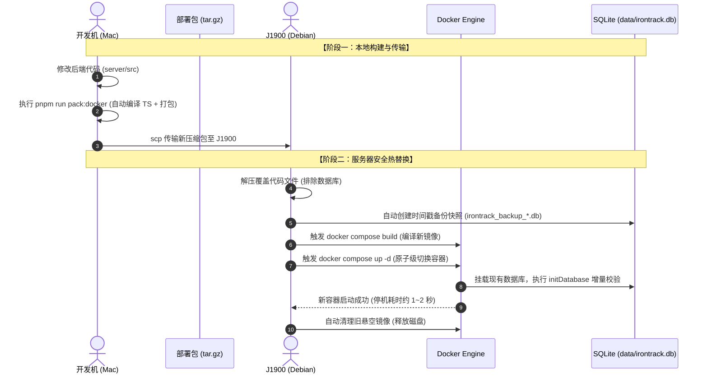

# IronTrack 后端服务更新与维护指南 (J1900 Debian Docker)

> **适用场景**：IronTrack 私有云后端（Express + TypeScript + better-sqlite3）  
> **目标硬件**：低功耗工控机 / 软路由 / 家用 NAS（以 Intel Celeron J1900、Debian 系统为例）  
> **核心目标**：实现代码更新后的**平滑替换**、**停机时间 < 2 秒**、**业务数据（SQLite）绝对零丢失**。

---

## 目录
- [一、 更新核心机制与数据安全保障](#一-更新核心机制与数据安全保障)
- [二、 常见更新方案选型对比](#二-常见更新方案选型对比)
- [三、 方案 A：离线包增量热更新（推荐，内网标配）](#三-方案-a离线包增量热更新推荐内网标配)
- [四、 方案 B：Git Pull 原地更新（适合 J1900 可连外网）](#四-方案-bgit-pull-原地更新适合-j1900-可连外网)
- [五、 方案 C：GitHub Actions + 镜像自动分发（高级 CI/CD）](#五-方案-cgithub-actions--镜像自动分发高级-cicd)
- [六、 数据库结构变更与兼容性迁移指南](#六-数据库结构变更与兼容性迁移指南)
- [七、 容灾与故障秒级回滚方案](#七-容灾与故障秒级回滚方案)
- [八、 J1900 低配设备日常维护与避坑清单](#八-j1900-低配设备日常维护与避坑清单)

---

## 一、 更新核心机制与数据安全保障

在进行任何服务更新前，最重要的原则是：**确保已有健身记录绝对安全，升级过程平滑无感。**

### 1. 为什么更新不会丢失数据？
IronTrack 的 Docker 架构采用**宿主机卷映射（Volume Mount）**机制：
```text
J1900 宿主机 (Debian)                       Docker 容器内部 (Alpine Linux)
~/gym-tracker-server/data/irontrack.db  <--->  /app/data/irontrack.db
```
- 容器本质上是“无状态”的，执行构建、销毁、重启操作只会替换运行代码（Node.js 运行环境与 `dist/` 编译产物）。
- 真实的 SQLite 数据库文件始终保存在宿主机外部的 `./data/` 目录中。
- 在打包脚本中，已强制排除 `data/*.db`，解压任何新安装包都不会冲掉已有的线上数据库。

### 2. 更新时序图



---

## 二、 常见更新方案选型对比

| 方案 | 适用网络环境 | 操作便捷度 | 优势 | 潜在门槛 |
| :--- | :--- | :--- | :--- | :--- |
| **方案 A：离线包热更新 (推荐)** | 纯内网 / Tailscale / 弱网 | 极简（两行命令） | 不依赖服务器 Git 凭据与外网访问；原生 C++ 编译零错位 | 每次改动需传输 ~30KB 压缩包 |
| **方案 B：Git Pull 原地更新** | J1900 可直连 GitHub/Gitee | 最快 | 无需手动传输文件，一行 `git pull` 搞定 | 服务器需配置 Git 权限或公钥 |
| **方案 C：GitHub Actions CI/CD** | 具备外网与公网 Docker 镜像源 | 全自动 | 云端统一构建，无本地编译负载 | 需要拉取外部镜像，受国内镜像源限速影响 |

---

## 三、 方案 A：离线包增量热更新（推荐，内网标配）

这是最稳妥、不受任何网络限制的经典家庭私有云部署方式。

### 步骤 1：开发机（Mac）修改代码并一键重新打包
当你在 `server/src/` 中修改了路由、数据库表或修复了 Bug 后：

1. 打开终端，进入 `server` 目录：
   ```bash
   cd /Users/chunxiao/Documents/web/me/gym-tracker/server
   ```
2. 运行打包命令：
   ```bash
   pnpm run pack:docker
   ```
   该命令会自动完成两项操作：
   - 触发 `tsc` 编译最新的 TypeScript 代码到 `dist/`；
   - 自动在项目根目录下更新生成 `gym-tracker-server-docker.tar.gz`（体积仅约 30KB）。

3. 将新包发送至 J1900：
   ```bash
   # 请将 <J1900_IP> 替换为小主机局域网 IP 或 Tailscale IP (例如 100.86.120.55)
   scp ../gym-tracker-server-docker.tar.gz debian@<J1900_IP>:~/
   ```

---

### 步骤 2：J1900（Debian）一键解压并平滑更新
SSH 登录到 J1900 Debian 小主机：

```bash
ssh debian@<J1900_IP>
```

直接执行以下命令：
```bash
# 1. 解压最新代码（会自动安全覆盖 gym-tracker-server 目录下的代码，绝不会影响 data 数据库）
tar -xzvf gym-tracker-server-docker.tar.gz

# 2. 进入目录并运行内置的安全更新脚本
cd gym-tracker-server
./update.sh
```

#### `update.sh` 会自动帮你做四件关键事情：
1. **自动备份快照**：自动将当前 `data/irontrack.db` 复制一份带有精确时间戳的备份文件；
2. **重构生产镜像**：读取最新代码重新打包镜像；
3. **平滑重启服务**：采用 `docker compose up -d` 重新加载容器，旧容器平滑停止，新容器接管端口；
4. **清理悬空镜像**：自动执行 `docker image prune -f`，避免多次更新后旧镜像挤占 J1900 宝贵的小容量 SSD 空间。

---

### 步骤 3：验证更新结果
执行更新后，可以在终端快速核对服务状态：

```bash
# 检查容器运行状态
docker compose ps

# 查看最新运行日志（确认没有报错并且数据库已就绪）
docker compose logs -f --tail 30
```
看到类似 `Server is running on http://0.0.0.0:3001` 及 `Database initialized` 即代表更新成功！

---

## 四、 方案 B：Git Pull 原地更新（适合 J1900 可连外网）

如果你的 J1900 Debian 本身可以直接连接 GitHub 或已配置内网代码仓库，可直接原地拉取更新：

```bash
# 1. 登录服务器并进入项目目录
cd ~/gym-tracker/server

# 2. 拉取最新代码
git pull origin main

# 3. 运行更新脚本
./update.sh
```

---

## 五、 方案 C：GitHub Actions + 镜像自动分发（高级 CI/CD）

项目中已配置自动化流水线文件 [`.github/workflows/docker-server.yml`](file:///Users/chunxiao/Documents/web/me/gym-tracker/.github/workflows/docker-server.yml)。

### 工作原理：
1. 每当你向 GitHub 提交 `server/` 相关的代码并推送（Push）到 `main` 分支时：
2. GitHub 云端 Runner 会自动拉起 **Ubuntu x86_64** 环境；
3. 为 `linux/amd64`（J1900 原生架构）编译出独立的 Docker 镜像，并自动压制为离线镜像包上传至 GitHub Actions Artifacts。
4. 如果绑定了 GitHub Container Registry（GHCR），可在 J1900 上直接执行：
   ```bash
   docker compose pull
   docker compose up -d
   ```

---

## 六、 数据库结构变更与兼容性迁移指南

在健身记录追踪系统中，后端代码迭代经常伴随着**数据库字段扩充**（如：在体测指标中增加骨骼肌含量、训练模板增加标签等）。

### 1. 结构变更的“追加型设计”（强烈推荐）
IronTrack 后端使用 SQLite 嵌入式数据库。为确保向后兼容与免手动迁移，新增字段建议使用追加模式：

```typescript
// server/src/db.ts
export function initDatabase() {
  // 原有建表语句保留 IF NOT EXISTS
  db.exec(`CREATE TABLE IF NOT EXISTS workouts (...);`);

  // 新增字段检查（自增式迁移，幂等安全）：
  try {
    const tableInfo = db.pragma('table_info(workouts)') as any[];
    const hasHeartRate = tableInfo.some(col => col.name === 'avg_heart_rate');
    if (!hasHeartRate) {
      db.exec(`ALTER TABLE workouts ADD COLUMN avg_heart_rate REAL;`);
      console.log('✅ 数据库迁移：已成功添加 avg_heart_rate 字段');
    }
  } catch (err) {
    console.error('数据库迁移检查异常:', err);
  }
}
```
通过上述写法，无论何时更新代码，容器重启时 `initDatabase()` 会自动检测并增量补充字段，**既不需要手动执行 SQL 迁移脚本，也不会破坏已有数据！**

---

## 七、 容灾与故障秒级回滚方案

如果在更新后发现新代码存在逻辑 Bug，或者前端 App 报错无法同步，可采用以下两套回滚方案：

### 方案 1：代码回滚（从上一个版本的本地包重新部署）
如果本地保留了上一个版本的代码或 Git 提交：
```bash
# 本机检出稳定分支或 Commit
git checkout <上次稳定版本的CommitID>
cd server
pnpm run pack:docker
scp ../gym-tracker-server-docker.tar.gz debian@<J1900_IP>:~/
```
在 J1900 上重新执行 `./update.sh` 即可。

### 方案 2：数据库快照秒级恢复
每次执行 `./update.sh` 时，系统都会在 `data/` 目录下生成类似 `irontrack_backup_20261010_163100.db` 的安全快照。

若更新后数据发生异常，恢复步骤如下：
```bash
# 1. 停止运行中的容器
docker compose down

# 2. 查看历史备份文件列表
ls -l data/irontrack_backup_*.db

# 3. 恢复最近一次的健康数据库快照
cp data/irontrack_backup_20261010_163100.db data/irontrack.db

# 4. 重新启动服务
docker compose up -d
```

---

## 八、 J1900 低配设备日常维护与避坑清单

J1900 作为经典的家用低功耗平台（2.0GHz 4核心 x86_64，通常为 4G/8G 内存及 32G/64G SSD），在日常容器化运维时有几点关键注意事项：

### 1. 磁盘空间防爆满（重要！）
Docker 多次构建后会产生悬空镜像（`<none>:<none>`）和构建层缓存。
- `update.sh` 已经内嵌了 `docker image prune -f`；
- 如果运行数月后发现磁盘空间吃紧，可在 J1900 上执行彻底清理：
  ```bash
  # 查看 Docker 占用空间
  docker system df

  # 一键清理所有废弃缓存（不会删除正在运行的容器和挂载的数据卷）
  docker system prune -a --volumes=false
  ```

### 2. 内存超限保护
当前 `docker-compose.yml` 中已经为服务设定了安全上限：
```yaml
deploy:
  resources:
    limits:
      memory: 256M
```
Node.js 运行时一般稳定在 **35MB ~ 45MB**。如果 J1900 内存紧张，该限制可保证后端服务绝不会因为突发内存泄漏而拖垮宿主机其他服务（如 OpenWrt / NAS 系统）。

### 3. 数据备份到外部存储
建议定期把 `data/irontrack.db` 备份到 NAS 共享目录或外部存储：
```bash
# 可在 Debian crontab 中添加每周定时备份任务
0 3 * * 0 cp /home/debian/gym-tracker-server/data/irontrack.db /mnt/nas_backup/irontrack_$(date +\%Y\%m\%d).db
```

---

## 九、 总结：极简备忘速查

后续日常开发中，每次改动代码后只需记住以下**两句话**：

```bash
# 电脑端 (Mac)：
cd server && pnpm run pack:docker && scp ../gym-tracker-server-docker.tar.gz debian@<J1900_IP>:~/

# 服务器端 (J1900)：
tar -xzvf gym-tracker-server-docker.tar.gz && cd gym-tracker-server && ./update.sh
```
全程耗时不到 1 分钟，全自动完成**编译、传输、备份、热切、清理**全流程！
